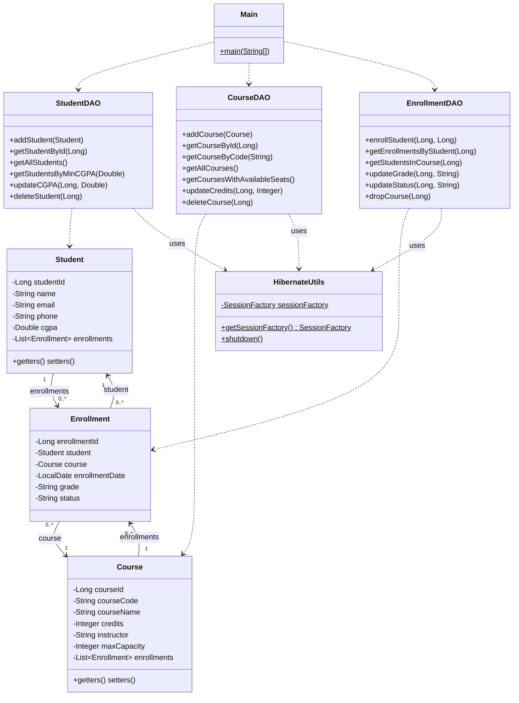
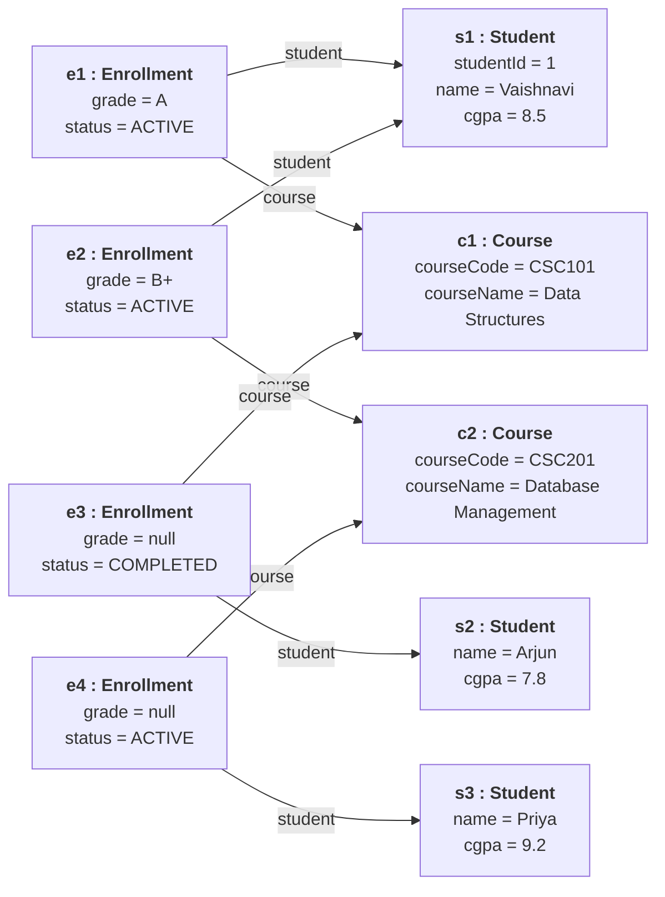
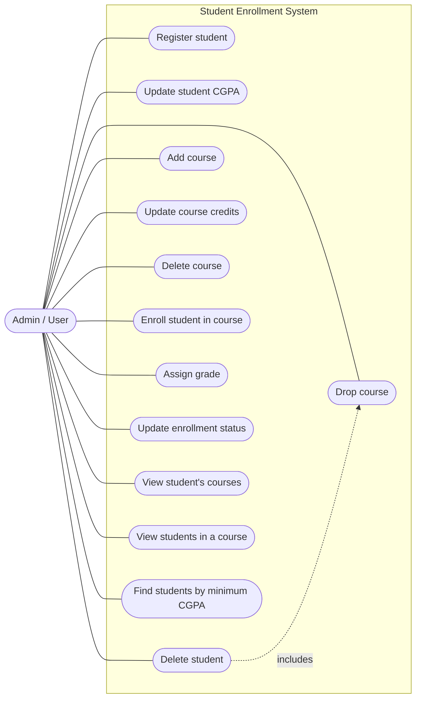
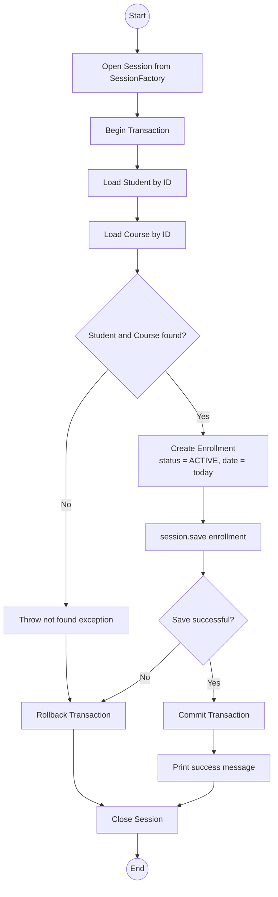
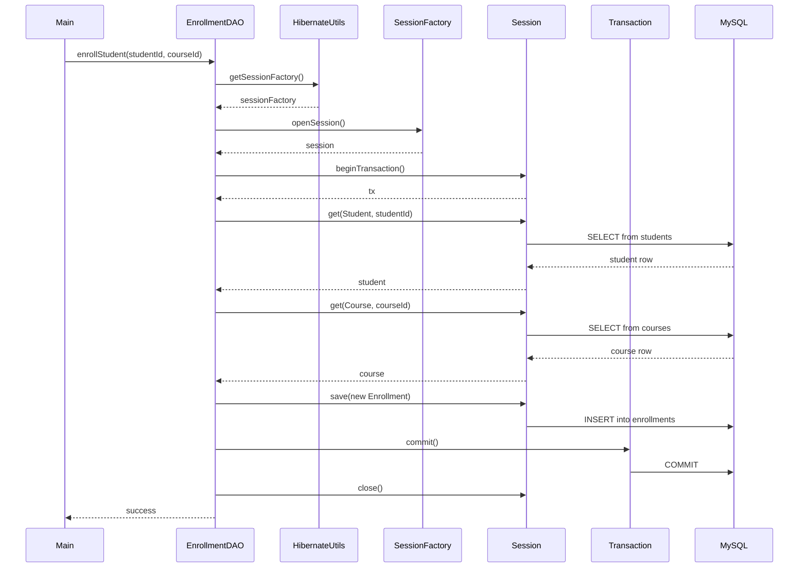
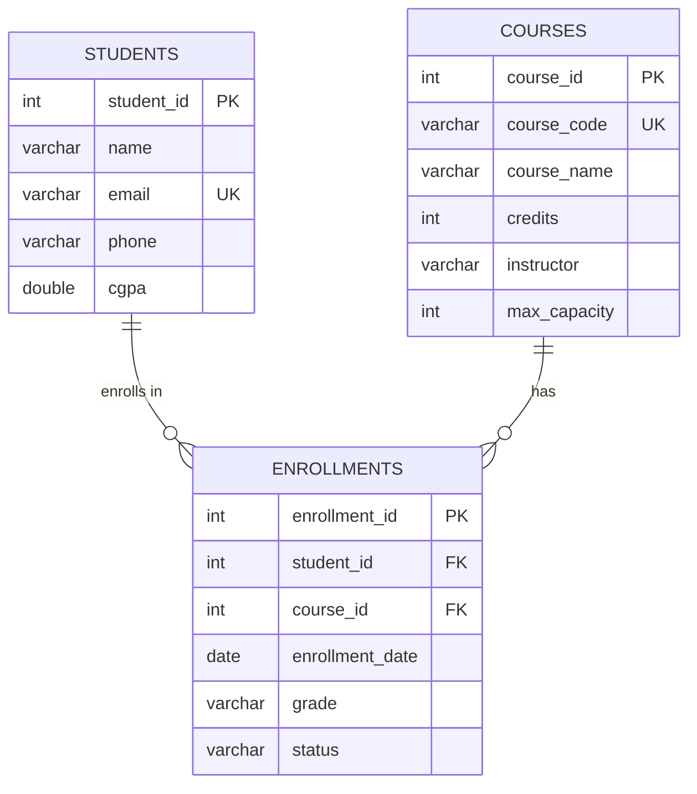
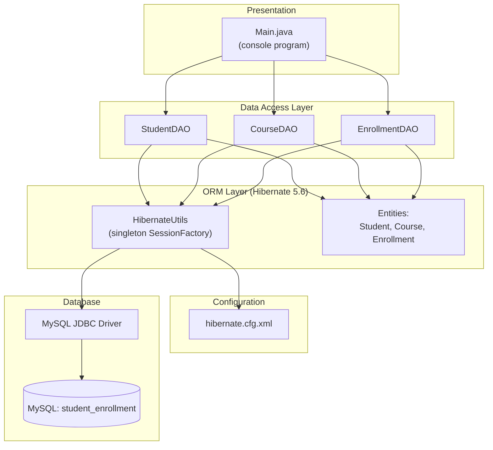

# UML and ER Diagrams: Student Course Enrollment System (Hibernate)

## 1. Class Diagram

 Entities hold data and mappings. DAOs hold the database operations. `HibernateUtils` is the shared SessionFactory.

## 2. Object Diagram

 Vaishnavi appears in two enrollments, so one student links to many courses. Data Structures has two students, which is the many-to-many relationship.

## 3. Use Case Diagram

eleting a student also removes their enrollments through `CascadeType.ALL`, which is why the diagram links the two use cases.

## 4. Activity Diagram (Enroll a Student)

 The transaction is all-or-nothing. A failure triggers a rollback, so no half-saved enrollment remains.

## 5. Sequence Diagram (Enroll a Student)

 Every DAO method follows this pattern: open session, begin transaction, do the work, commit, close.

## 6. ER Diagram

`ENROLLMENTS` is the junction table holding both foreign keys, which gives the many-to-many relationship.

## 7. Component Diagram

 Each layer talks only to the layer below it. The UI never uses Hibernate directly.